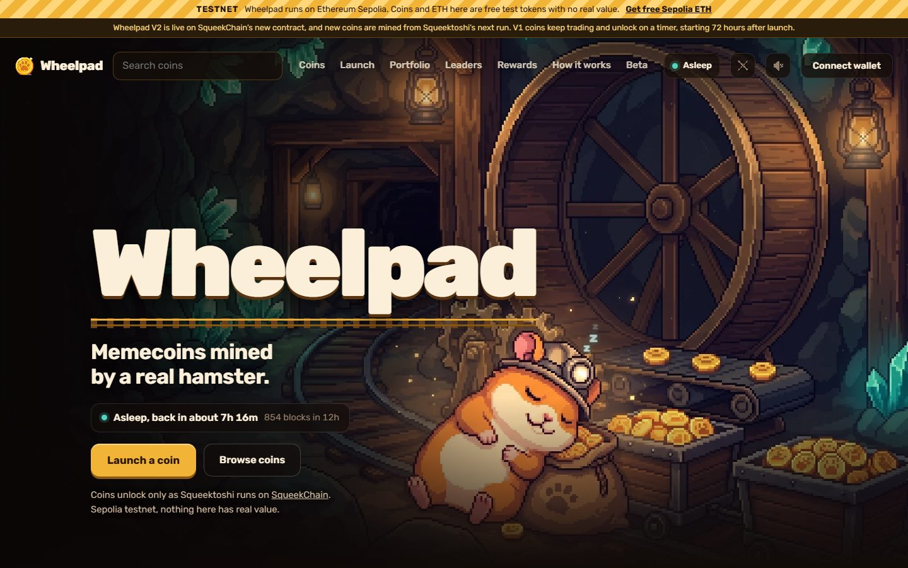
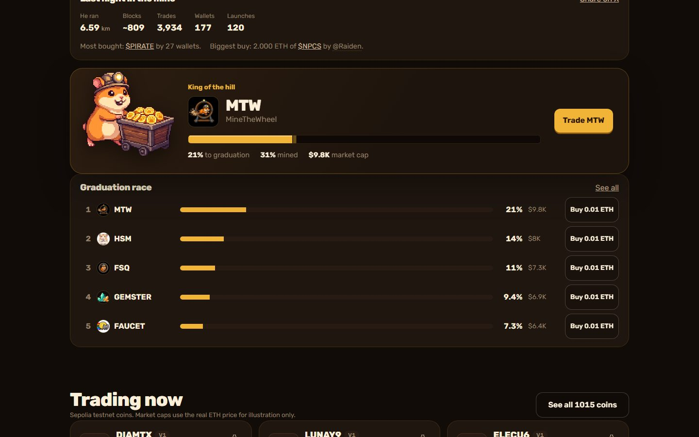
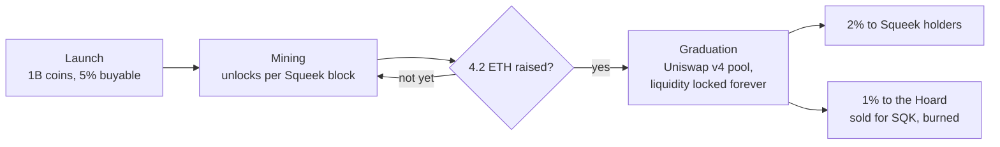
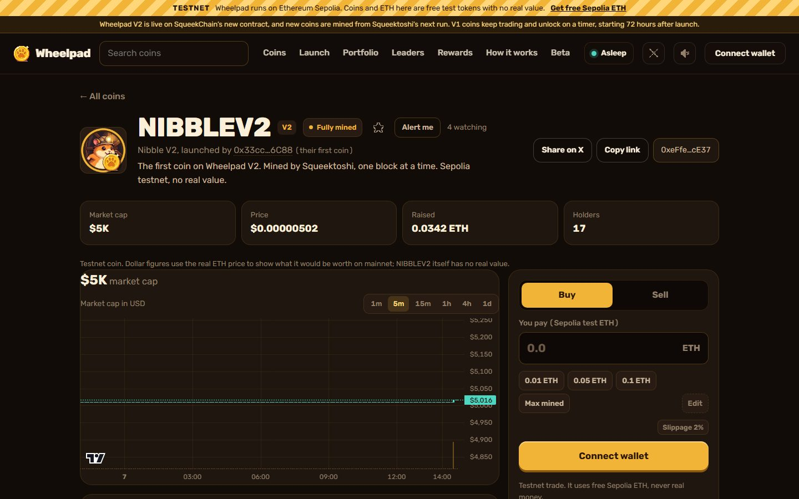
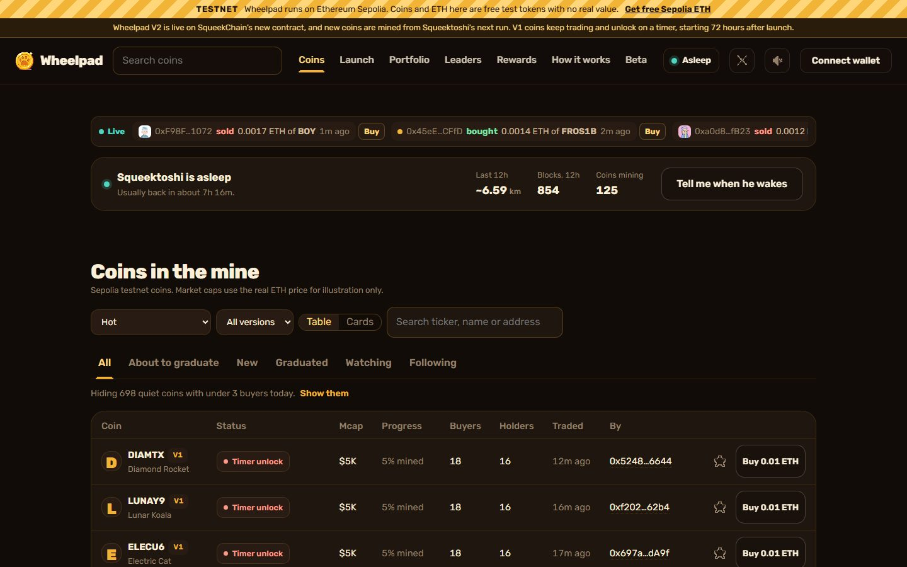
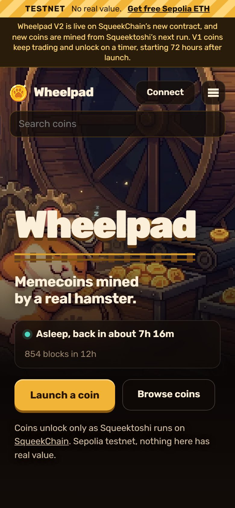
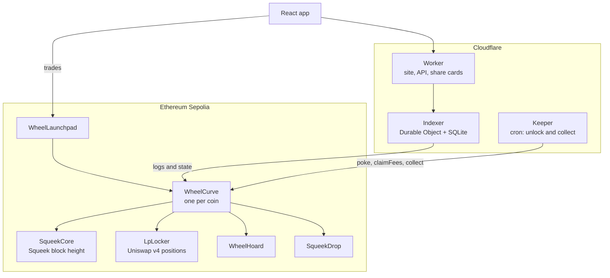
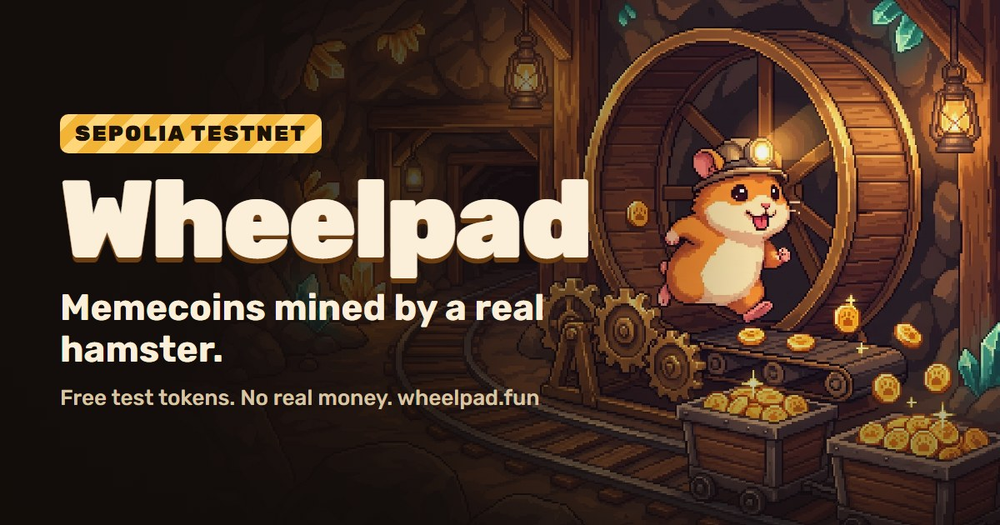

  

<h1 align="center">Wheelpad</h1>

  <b>Memecoins mined by a real hamster.</b> 
  A memecoin launchpad on <a href="https://docs.squeekchain.com">SqueekChain</a>, where a coin's supply unlocks only as Squeektoshi runs his wheel.

  <a href="https://wheelpad.fun"><b>wheelpad.fun</b></a>&nbsp;&nbsp;&nbsp;
  <a href="https://wheelpad.fun/how">How it works</a>&nbsp;&nbsp;&nbsp;
  <a href="https://x.com/wheelpadfun">@wheelpadfun</a>

  
  
  
  

> [!NOTE]
> Wheelpad runs on the Ethereum **Sepolia testnet**. Every coin and every ETH on it is a free test token with no real value.

---

## Why a hamster

On most launchpads a coin's whole supply can be bought in the first block, so bots and insiders take it before anyone else has even seen the coin.

On Wheelpad, supply is **mined**. SqueekChain measures a real hamster, Squeektoshi, running on a real wheel, and settles his work on Ethereum as *Squeek blocks*. Each coin unlocks a slice of its supply for every Squeek block he completes, dripping in over ten minutes. Nobody can buy what he hasn't mined yet, however fast their bot is.

  

## How a coin works

1. **Launch.** One transaction creates the coin and its bonding curve. A billion coins, all held by the curve. 5% can be bought straight away, so the coin trades from its first minute. The creator can make an opening buy of up to 2% of supply.
2. **Mining.** The creator picks how long Squeektoshi takes: about a night (1,000 Squeek blocks), three nights or a week. Every block he completes unlocks its share of the rest, released over ten minutes.
3. **Graduation.** Once 4.2 ETH has been raised, the coin moves to a Uniswap v4 pool. The liquidity is locked forever in a contract with no withdraw function.
4. **After graduation.** 2% of the supply goes to Squeek NFT holders, weighted by their mining power during the nights the coin was mined. 1% goes to Squeektoshi's Hoard.

  

## Fees

| | Rate | Where it goes |
|---|---|---|
| Trading on the curve | 1% | Half to the coin's creator, half to the protocol, paid inside each trade |
| Trading after graduation | 1% pool fee | Buys: ETH split 50/50 between creator and protocol. Sells: the coin side is burned |
| Launching | Free | You only pay gas |

## Safety by design

| Property | How |
|---|---|
| **No pre-mine, no team allocation** | Every coin is minted to its curve at launch, and the curve checks that nothing exists outside it before it can trade |
| **No admin keys on coins or curves** | No owner, no mint, no pause, no fee switch. A coin keeps the settings it launched with forever |
| **Liquidity locked forever** | The locker that holds graduated pool positions has no withdraw function |
| **Speed limit** | A curve credits at most 80 Squeek blocks per 10 minutes, about 1.25x the fastest round ever measured, so a misreporting oracle can't rush a coin |
| **Never frozen** | If SqueekChain stops reporting for 72 hours, a coin's remaining supply unlocks on a 7-day timer instead |
| **Graduation can't half-happen** | A buy that would graduate a coin reverts unless it carries enough gas for the whole graduation, so a wallet can't pick a limit where the buy lands and graduation silently fails |

## The Hoard

Every coin gives 1% of its supply to Squeektoshi's Hoard, a contract with no withdraw path. At graduation, and again at $100K, $500K and $10M market cap, the Hoard can sell a quarter of its coins, never below 90% of the milestone price. The ETH buys SQK, SqueekChain's token, at most 0.25 ETH an hour, and sends it to the burn address.

## The site

  

- **Live everything:** trades, launches and graduations stream in over WebSockets. The header shows whether Squeektoshi is running, and how fast, straight from SqueekChain's measurement feed.
- **Trust signals:** each coin shows its top holders, whether several of them were first funded by the same wallet, how concentrated the supply is, and the creator's record.
- **People:** names, profiles, follows, a Following feed and leaderboards.
- **Alerts:** a ping when he wakes, when a coin nears graduation, or when someone you follow launches.
- **Nightly recap:** how far he ran, how many blocks he mined and what traded, with a share card for every night.

  

## Architecture

| Layer | Built with |
|---|---|
| Contracts | Solidity 0.8.26, Foundry, Solady, Uniswap v4 |
| Indexer and API | Cloudflare Workers and a Durable Object with SQLite, WebSockets for live updates, several RPC sources with automatic fallback |
| App | React, Vite, viem, lightweight-charts |
| Share cards | satori and resvg, drawn at the edge |
| Keeper | A Cloudflare cron that unlocks mined supply and collects fees for creators and the protocol |

The bonding curve copies the shape the big launchpads use: an opening virtual reserve of 2.1 ETH, with graduation at 4.2 ETH raised. That is two thirds of the curve sold, at about 9x the opening price.

## Contracts (Sepolia)

Every contract is verified on [Sourcify](https://sourcify.dev); the links open them on Blockscout.

| Contract | Address |
|---|---|
| WheelLaunchpad (V2) | [`0x3bC144C0236AaaA6DAcfAaD62A598Ef6FadCC92E`](https://eth-sepolia.blockscout.com/address/0x3bC144C0236AaaA6DAcfAaD62A598Ef6FadCC92E) |
| EthZap | [`0x711E04B8a4F4BC4d8d41bd76919c90af6d20258e`](https://eth-sepolia.blockscout.com/address/0x711E04B8a4F4BC4d8d41bd76919c90af6d20258e) |
| LpLocker | [`0xB38F7E15e3E60B7Da0a872753FBfb66981aA343D`](https://eth-sepolia.blockscout.com/address/0xB38F7E15e3E60B7Da0a872753FBfb66981aA343D) |
| WheelHoard | [`0xbf6C3438b7879bdDeE733bCe0b9e6C654eDcCB40`](https://eth-sepolia.blockscout.com/address/0xbf6C3438b7879bdDeE733bCe0b9e6C654eDcCB40) |
| SqueekDrop | [`0x81678bd5df529839980279d716f1c6b32D7Dd931`](https://eth-sepolia.blockscout.com/address/0x81678bd5df529839980279d716f1c6b32D7Dd931) |
| FeeRecipient | [`0x3926Fd7b0c38A974aEe34610a278FDB4bb22ABbB`](https://eth-sepolia.blockscout.com/address/0x3926Fd7b0c38A974aEe34610a278FDB4bb22ABbB) |
| SqueekCore (SqueekChain) | [`0xFD6C166D4B8E2962E65746a13e5a0797CD4dE0c4`](https://eth-sepolia.blockscout.com/address/0xFD6C166D4B8E2962E65746a13e5a0797CD4dE0c4) |

Coins launched on the first launchpad, [`0x2462751aBD755B0CbA3056139cfF43d68600B0C5`](https://eth-sepolia.blockscout.com/address/0x2462751aBD755B0CbA3056139cfF43d68600B0C5), show as **V1**. They keep trading, but SqueekChain has since moved to a new contract, so their remaining supply unlocks on the timer.

## Try it

1. Get free Sepolia ETH from a [faucet](https://cloud.google.com/application/web3/faucet/ethereum/sepolia).
2. Open [wheelpad.fun](https://wheelpad.fun) and connect any browser wallet.
3. Buy a coin, or launch your own. Squeektoshi usually runs from about 22:00 UTC.

  

---

squeekchain-project: 2ff3ed67-e25d-4e55-b4a5-3d7dab88d42d
